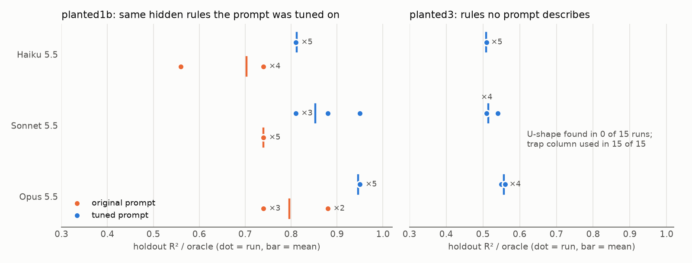
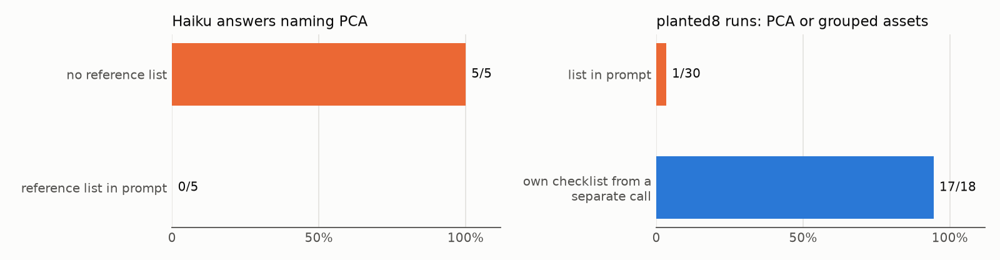
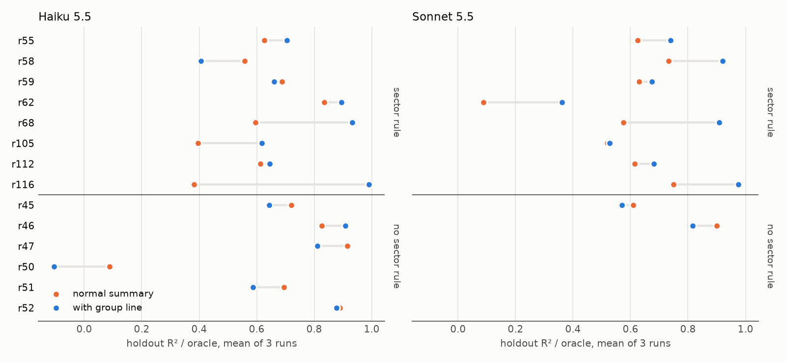
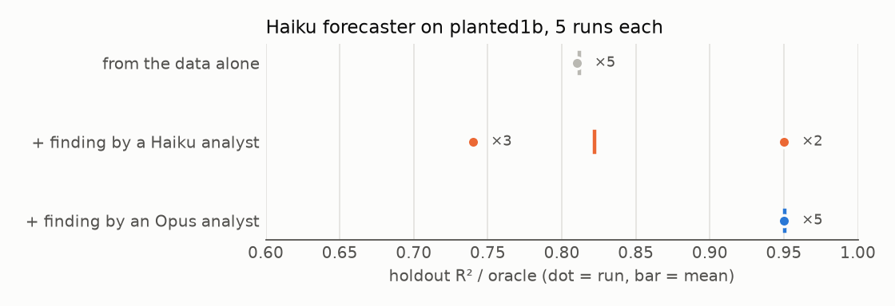
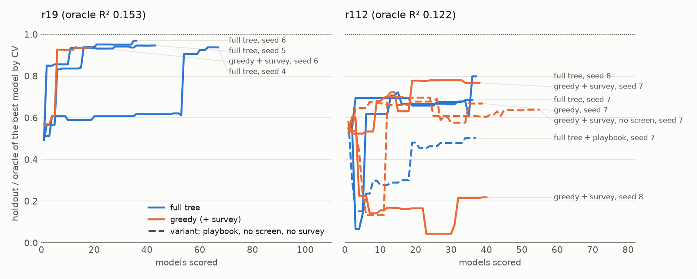
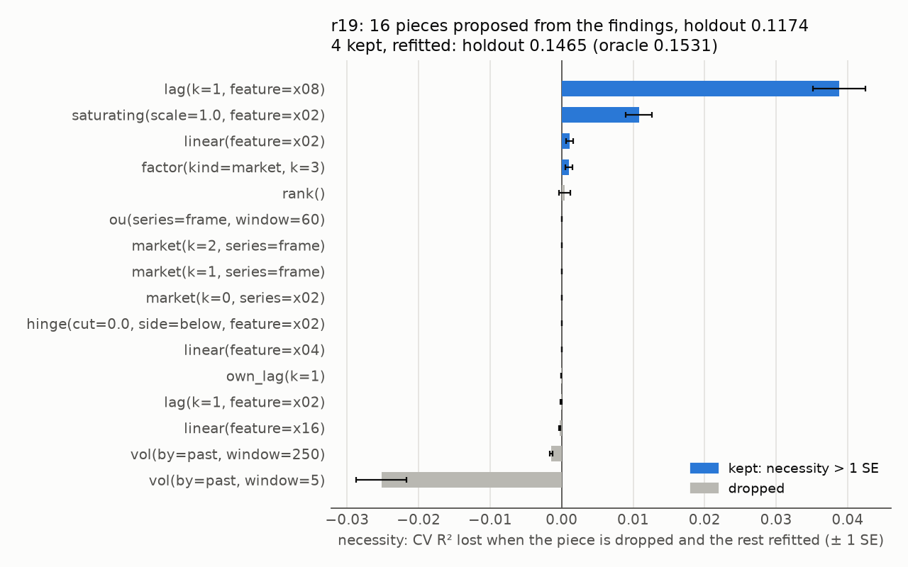

# agentic-research-harness

A testbed for agent structures, built on the Claude Agent SDK. Agents do
quantitative research: they explore a table of data, write up findings and
build a forecasting model. The data is synthetic, with hidden rules written
down by the generator, so every claim and every forecast can be graded
against the truth. The point of the project is the harness around the agents:
what structure (roles, handoffs, tools, search, typed models) makes them find
the rules, and how to measure that without fooling ourselves.

Scores below are holdout R² divided by the oracle's R² (the best possible
forecast, computed from the hidden rules): 1.0 matches the oracle, 0 is no
better than predicting the average.

## What stays fixed

Every structure below runs on the same base:

- **A note store instead of messages.** Agents never talk directly. They read
  and write notes in a SQLite store with full-text search, exposed as an MCP
  server. Notes cite notes, and the store checks who may write what. Because
  agents share only the store, any agent can be run alone with fixed starting
  notes.
- **Sandboxed shell.** Agents run Python through Bash inside the Claude Code
  OS sandbox: their own folder only, no network, no host settings, one BLAS
  thread per run.
- **Isolated scoring.** A forecast is a Python model file. The harness runs it
  in a separate sandboxed process fed one day at a time, so it cannot look
  ahead. The agent sees cross-validation scores; the holdout score is stored
  and never returned to it.
- **Limits and traces.** Turn limit, cost cap and timeout on every run; every
  message goes to a JSONL trace that the graders and an access audit read
  (472 runs, no read of a hidden file).
- **Any model.** Claude models, and gpt-oss through Ollama's
  Anthropic-compatible API, with the same tools.

## The structures we tried

Each stage started from a problem the previous one exposed. Most fixes changed
the structure around the agents, not the instructions to them.

### 1. Role agents over a shared store

Three agents, each one Markdown file whose frontmatter lists its tools and the
note kinds it may write ([src/arh/agents/](src/arh/agents/)): an *analyst*
explores the data and writes findings, an *ideator* proposes ideas from a data
summary without seeing raw data, a *forecaster* reads the notes and files a
model. `arh loop` lets them take turns over one store. This is where the
project started, and the evals were built to test it.

### 2. Sealed evals, after our own prompt cheated

Our first improved prompt raised scores by 0.11 to 0.15. Its two new checks
were exactly the two hidden rules of the dataset we wrote it on. On a dataset
no prompt describes, all three models missed the main rule in 15 of 15 runs
and used the trap column in 15 of 15.



Since then every change records what it was written against, and only a
sealed exam (six datasets built by a separate agent, run once with frozen
prompts, [protocol](docs/exam.md)) counts as a fair test. Opus came within 8%
of the oracle on every exam dataset with a pattern
([details](docs/results.md#1-telling-the-agent-what-to-look-for)).

### 3. A separate planning call

A reference list of quant practice in the prompt made Haiku stop proposing
PCA. Rewording did not help. What did: a `plan:` line in the agent's
frontmatter makes the runner first ask the model, in a call that never sees
the list, to write its own checklist, then starts the agent with it.



Instructions can displace what the model already knows
([details](docs/results.md#2-the-reference-list-makes-the-model-forget-what-it-knows)).

### 4. Computed tools over instructions

A prompt line telling Haiku to compare a column with its sector average
changed nothing. Computing that comparison into the data summary (the *group
line*) raised the mean score on new worlds with a sector rule by 0.15 for
Haiku and 0.16 for Sonnet. On worlds without one it did not help (Haiku did worse on 4 of 6).



A text-match grader had credited Haiku with the sector rule in 10 of 13 runs
that never used it; the rule now has to appear in the model code
([details](docs/results.md#5-why-haiku-fails-exam3)).

### 5. Handoffs as fixed starting notes

Because agents share only the store, a handoff can be frozen and replayed:
run the forecaster alone, with a Haiku analyst's finding, or with an Opus
analyst's finding.



A Haiku forecaster reaches 0.95 in 5 of 5 runs when handed one finding by an
Opus analyst. Much of the gap between models is in the research, not the
modelling ([details](docs/results.md#7-handing-notes-between-agents)).

### 6. Tree search over models

Fixed roles do one pass. `arh search` instead grows a tree of notes and model
files: a Thompson-sampling bandit picks a node and a typed move (survey,
residuals, draft, act on a finding, simplify, merge, ...), a searcher agent
carries out one move per step, and a ledger records every model's CV and
holdout. The plot shows, after each model scored, the holdout of the model
the search would hand in (best by CV).



It reaches 0.94 to 0.97 of the oracle on one random world and 0.66 to 0.80 on
a harder one, but does not yet beat a greedy search, and seeds matter more
than settings on the harder world. Its screening tool turned out to mirror
the generator's families, so there is a `--no-screen` control arm
([details](docs/results.md#8-tree-search-over-models)).

### 7. From a score to an explanation

A good model file does not say why it works. Models can now be a sum of named
pieces (`Pieces`), each instantiated from a mechanism template with a claim
and a measured *necessity*: the CV R² lost when it is dropped and the rest
refitted. One Haiku call turns a tree's findings into such a theory; pieces
whose necessity is not above one standard error are dropped and the rest
refitted.



On r19 the 16 proposed pieces score 0.117; the 4 kept find both planted rules
with no false positive and score 0.147 against an oracle of 0.153, as well as
the best free-code model. On r112 it failed: no template expresses a gate on a
feature's own trailing correlation, and Haiku invented a column
([details](docs/results.md#9-from-a-score-to-an-explanation)).

### What carried through

- **Structure beats instructions.** Separate calls, computed summaries and
  typed moves changed behaviour; prompt lines mostly did not.
- **Check every change for leaking the answer.** A prompt line, a summary
  statistic or a tool written after seeing a dataset measures instruction
  following on that dataset, not discovery.
- **Grade the graders.** Text-match checks overcredit; the same kind of check
  still credits a lead-lag rule too easily (section 9 of the results).

## The evals

A generator builds each dataset: 40 assets over 700 days, 16 numeric columns
and the next-day return. It plants a few rules, adds a trap column (a noisy
copy of a real one), writes both to a hidden file, and holds back the last
200 days. One eval is one agent, a fixed set of starting notes, one dataset
and one prompt version; `arh eval` runs it N times in parallel and grades
every run. Prompt versions sit side by side in `evals/prompts/`, so an
ablation is a grid of model × prompt × dataset.

Every run is graded on four groups of metrics ([src/arh/evals.py](src/arh/evals.py)):

- **How did it work?** Finished and filed one allowed note; turns, tool calls,
  error rate, repeated calls, read before writing, models scored, tokens,
  time, cost; which analyses its code ran
  ([per-model tables](docs/results.md#6-how-each-model-uses-its-tools)).
- **Is the note backed by work?** Share of the note's numbers that appear in
  its own tool output, whether cited notes were actually returned to it,
  whether an analyst's script reruns to the numbers in its note; an Opus judge
  rates specificity, evidence, actionability, clarity and correctness.
- **Did it find the truth?** For each hidden rule, whether the model code uses
  all the rule's columns in a matching form; whether the trap column is an
  input; how many noise columns the note mentions.
- **Forecast quality.** The score above, daily rank correlation, and the
  Sharpe ratio of a long-short portfolio from the forecast.

Each setting runs 3 to 10 times; comparisons give a 95% interval from a
bootstrap over runs and blocks of held-back days. Most results cover a few
worlds and few runs; [docs/results.md](docs/results.md) has the full tables
and limits.

## Code

| file | job |
|---|---|
| `runner.py` | one agent run: prompt, planning stage, tools, sandbox, limits, trace |
| `tools.py` | the store and scoring as MCP tools, scoped per agent |
| `store.py` | notes (full-text search), runs, scored models, requests |
| `score.py`, `worker.py` | walk-forward CV, hidden holdout, sandboxed model process |
| `summary.py` | the data summary every agent starts with |
| `search.py`, `screen.py` | tree search over notes and models; the feature screen |
| `mechanisms.py`, `theory.py` | mechanism templates, `Pieces` models, necessity, grading against the truth |
| `evals.py` | eval cells, graders, LLM judge, scorecards |
| `cli.py` | `arh init / run / loop / search / eval / regrade / report` |
| `worlds/` | dataset generators |

## Run it

```bash
python -m venv .venv && .venv/bin/pip install -e '.[dev]'
.venv/bin/pytest -q
scripts/reproduce.sh     # rebuilds the datasets, tables and figures from results/, no model calls
```

Running agents calls the models (Haiku costs about $0.005 to $0.07 per run):

```bash
.venv/bin/arh eval all --spec evals/planted3.json --model claude-haiku-5-5 --n 5 \
  --max-turns 15 --prompts evals/prompts/cur --out runs/evals/planted3/haiku.jsonl
.venv/bin/arh report --scorecard runs/evals/planted3/haiku.jsonl
```

A tree search, then a theory from its findings (about $0.35 to $0.55 for 60 Haiku steps):

```bash
.venv/bin/python worlds/make_random.py 19     # a random world; the draw depends only on the seed
.venv/bin/arh search r19-tree --world worlds/rand/r19 --steps 60 --parallel 3
.venv/bin/python scripts/theory_from_findings.py runs/r19-tree worlds/rand/r19 runs/r19-tree/theory
```

## Next steps

- A prune move inside the tree, so the search itself keeps only pieces with
  positive necessity, and sufficiency tables for `Pieces` models.
- A full `--pieces` search against free code on several worlds and seeds.
- A template for gating on a feature's own trailing correlation, the gap that
  made the r112 theory fail.
- A benchmark of tree against greedy search on 6 worlds × 3 seeds, with
  families the screen covers reported apart from those it does not.
