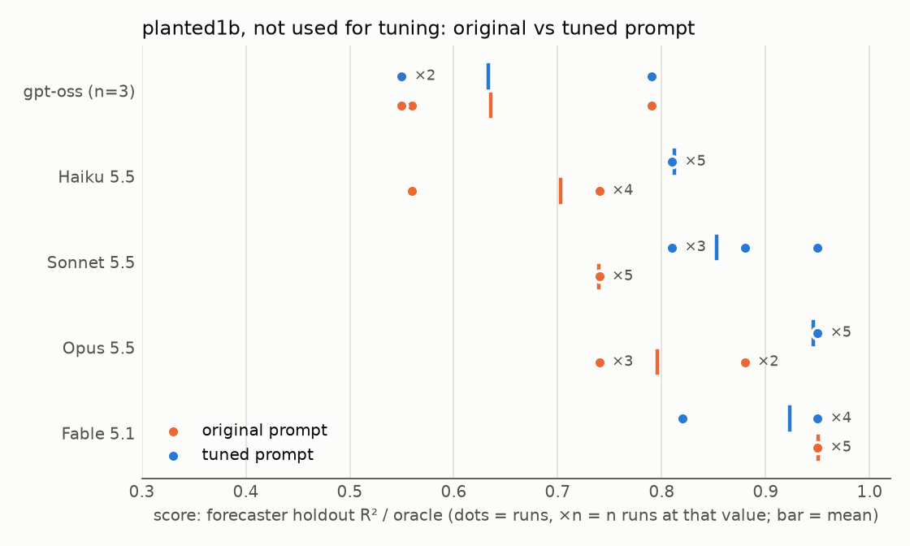

# agentic-research-harness

LLM agents (Claude Agent SDK) look for planted mechanisms in synthetic panels
with a known truth, so every claim and forecast is graded against the answer.

- **Prompt tuning transfers to held-out seeds:** forecaster score rose from
  0.70 to 0.81 of the oracle for Haiku and from 0.80 to 0.95 for Opus, with no
  loss on a control world.
- **A reference primer pushes out methods the model knows:** with the primer,
  Haiku's plans drop PCA from 5/5 to 0/5. A separate plan call before the
  primer restores them: on planted8, PCA in agent code went from 1 of 30
  runs to 17 of 18.
- **Sealed exam:** on six worlds built by a separate agent and run once with
  frozen prompts, Opus scored 0.92 or more of the oracle on every world with
  signal, and no model overfit the null world.
- **The agents cannot see the answers:** an audit of 472 run traces and a
  deliberate break-in attempt found no read of the holdout or truth files.

## Introduction

We test whether LLM agents find structure in data that they were not told to
look for. We use synthetic data with a known data-generating
process, so that we can check an agent's claims against the truth.

Each synthetic dataset (a "world") is a panel of 40 assets observed on 500
dates with 16 features, and the task is to forecast next-period `y`. Each world
contains a few planted mechanisms, for example a feature that matters only when another
feature is positive. It also contains a decoy feature that is correlated with
`y` only through one of the planted ones.

Three agents work on the task. The analyst studies the data and writes
findings, the ideator proposes mechanisms without seeing the raw data, and the
forecaster builds a model.

### How the agents are built

The agents run on the Claude Agent SDK. Each agent is a single Markdown
prompt whose frontmatter lists the tools it may use and the kinds of note it
may write. The agents communicate only by reading and writing notes in a
shared SQLite store with full-text search (a blackboard architecture). An MCP
server exposes the store to the agents, with tools scoped per agent: the
ideator has no shell, and the store rejects a forecast filed by the ideator.

The analyst and forecaster run Python through a Bash tool inside the Claude
Code OS sandbox, which has no network and cannot read the holdout or the
truth file ([Access](#access-to-the-holdout-and-truth-files)). A forecast is a model
file. The harness scores it in a separate worker process that receives one
date at a time, so the model cannot look ahead. The agent sees walk-forward
cross-validation scores on its training data, and the harness stores the
holdout score without returning it. Each run has a turn limit and a cost
limit. The harness writes every message to a trace file, and the grounding
checks and the access audit below read these traces. We serve models other
than Claude (here gpt-oss) locally through Ollama's Anthropic-compatible API,
with the same tools.

Because the agents share only the store, we can evaluate each one alone. An
eval condition is one agent, a fixed set of starting notes, and a world. We
keep each prompt version in its own directory, so an ablation is a grid of
model × prompt version × world, and we judge a prompt change by rerunning one
agent's eval instead of the whole loop. We tuned the prompts on planted1,
checked them during tuning on a control world without a regime effect
(planted2), and evaluated them on a new seed of planted1 (planted1b).

### What we measure

We grade every run against the world's truth file. The main outcome is the
forecaster's holdout R² divided by the oracle's holdout R², where the oracle is
the true conditional mean. We also record which planted mechanisms an agent
names in its note or model code, and whether the decoy ends up in the model.
To check that a note rests on work the agent did, we test whether its numbers
appear in the agent's tool output, whether the notes it cites were returned to
it by a tool, and whether the analyst's script reproduces its numbers when we
rerun it. The process metrics are turns, tool calls, tool error rate, repeated
calls, number of models tried, wall time and cost, plus a regex check for
which analyses appear in the agent's code (regime split, lags, nonlinearity,
cross-asset). Opus 5.5 scores each note from 1 to 5 for specificity, evidence
and actionability, and rates it correct, partial or wrong against the truth.

### Results

We ran Haiku, Sonnet, Opus, Fable and a local gpt-oss model, with five runs
per setting (three for gpt-oss). We did not compute a minimum detectable
effect, and we do not treat a difference of one or two runs out of five as a
result.

We tuned the prompts on planted1. The main additions tell the agents to split
the data by regime and to check whether one feature is a proxy for another.
On planted1b, which we did not use for tuning, these additions raised the
forecaster's score from 0.70 to 0.81 of the oracle for Haiku, from 0.74 to
0.85 for Sonnet and from 0.80 to 0.95 for Opus. On the control world
planted2, every model scored between 0.90 and 0.92 with both prompts, so the
extra instructions did not lower the score where there is no regime effect
([Section 1](#1-tuned-prompts-on-worlds-not-used-for-tuning)). On planted1b, a Haiku forecaster
working from a finding written by an Opus analyst scored 0.95 of the oracle in
5 of 5 runs.

The prompt additions describe the kind of mechanism planted in planted1, and
this may explain the gains. To test this we built planted3, whose mechanisms
the prompt does not mention. The main one is a U-shape in a single feature,
which has almost no linear correlation with the target. With the tuned
prompts, the Haiku, Sonnet and Opus analysts did not find it in any of 15
runs, and their forecasters put the decoy in the model in all 15. We then added one line to the analyst prompt, asking it
to regress its strongest feature on the other features and their squares.
With this line Haiku found the U-shape in 5 of 5 runs, and in 4 of 5 on a
second seed. The line mentions squares, which is the planted form, so we still
need to test it on a world with a different nonlinearity
([Section 3](#3-mechanisms-that-no-prompt-describes)).

A reference primer can push out methods the model already knows. Asked with
no primer to plan its checks of a returns panel, Haiku lists PCA and
industry clustering in 5 of 5 plans. With the primer in the prompt, it lists
PCA in 0 of 5 and industries in 0 to 2 of 5, wherever the primer is placed.
Its plans stay about the same length, so the primer's items take the place of
its own. Opus lists both in 5 of 5 plans in every setting, but in agent runs
on planted8 it did not run PCA in any of 6 runs
([Section 4](#4-the-primer-pushes-out-what-the-model-knows)).

In planted3 the forecaster's score depends on what the analysts find. A
forecaster given a note that names all three mechanisms matches the oracle,
and one given a single analyst finding scores 0.56 to 0.63 of the oracle.

On six sealed exam worlds, built by a separate agent and run once with
frozen prompts, Opus scored 0.92 to 1.0 or more of the oracle on the five
worlds with signal, and neither model overfit the null world. The separate plan
call scored the same as the primer alone there; its gain shows only on planted8c,
where the method needed is missing from the primer
([Section 5](#5-sealed-exam)). Some exam scores exceed 1.0 of the oracle.
On exam2 the stated oracle leaves out information in past y, so it is not the
best feasible forecast. On exam5 the oracle's own holdout R² is low by chance
(0.026 against 0.038 on the training dates). Neither is a grading error.

On exam3 Haiku scored 0.03 to 0.14 because it never subtracted a
feature's date × sector mean, although it can build that model when told. One
extra line in the data summary, a per-group variance decomposition, put that
feature in 9 of 9 Haiku models on three random worlds it was not built on, and
it put a decoy group code into none of 6 on two control worlds
([Section 6](#6-why-haiku-fails-exam3-numbers-in-the-data-summary-beat-an-instruction)).

We also checked that the agents cannot read the holdout, the truth file or
the generators, by auditing the traces of 472 runs and by instructing an
analyst to try ([Access](#access-to-the-holdout-and-truth-files)).

## Code

The core is about 850 lines of Python and the eval module about 420.

| agent | sees | tools | writes |
|---|---|---|---|
| analyst | data, all notes | sandboxed Bash, store | finding |
| ideator | data summary, notes (no raw data) | store | idea, question |
| forecaster | data, all notes | sandboxed Bash, store, `score_model` | forecast |

| file | job |
|---|---|
| `store.py` | notes (FTS5), runs, trials |
| `tools.py` | store and scoring as MCP tools, scoped per agent |
| `runner.py` | one agent run: prompt, tools, sandbox, trace |
| `score.py`, `worker.py` | walk-forward CV, hidden holdout, sandboxed model worker |
| `evals.py` | eval conditions, graders, scorecards |
| `agents/*.md` | one prompt per agent (frontmatter: tools, writable kinds) |

## Detailed results

### Setup

Each run is one agent (analyst or forecaster) that starts from a fixed set of
notes on one world and has at most 15 turns. Most cells have 5 runs, and the
gpt-oss cells have 3. A forecaster's score is its holdout R² divided by the
oracle's holdout R², so a score of 1.00 means it predicts as well as the true
model. An agent "found" a mechanism if the grader detects it in the agent's
note or model code, and a forecaster "used the decoy" if the decoy feature is
an input to its model. In the tables, ± is the standard deviation over runs
and a range is the minimum and maximum over runs.

The worlds:

| world | planted mechanisms | decoy | role |
|---|---|---|---|
| planted1 | y rises with the within-date rank of x03; x07 predicts y only on dates where the date-level feature x11 is positive (the "x07 gate"); y is positively autocorrelated at lag 1 | x05, a noisy copy of x03 | used to tune the prompts |
| planted1b | as planted1, with a different random seed | x05 | tests the tuned prompts |
| planted2 | y rises linearly with x09 and with the within-date rank of x02; y is negatively autocorrelated at lag 1 | x06, a noisy copy of x09; x13, a date-level feature that gates nothing | control without a regime effect, also checked during tuning |
| planted3 | y rises with x04² (a U-shape, with linear correlation near zero); x10 acts with a two-period delay; assets 20 to 39 follow the previous return of asset a−20 | x12 = x04² + noise | mechanisms that no prompt describes |
| planted3b | as planted3, with seed 13 and the mechanisms moved to x08 and x14 | x01 | second seed of planted3 |

The prompt versions (directories in `evals/prompts/`):

| prompt | content |
|---|---|
| original (`v1`) | the first version of each agent prompt |
| tuned (`cur`) | the original prompt plus an instruction to check whether an effect depends on a regime (a date-level feature above or below its median), an instruction to fit y on both features of a correlated pair and report which keeps its effect, and the data summary in the system prompt |
| tuned + EDA instruction (`eda`) | adds "correlation ≈ 0 is not no effect: check deciles, lags > 1, other assets" |
| tuned + squares instruction (`move`) | adds "ask what explains your strongest feature: regress it on the other features and their squares" |
| no data summary | the tuned prompt without the per-feature data summary (`ARH_SUMMARY=none`) |



### 1. Tuned prompts on worlds not used for tuning

We ran the original and the tuned prompts on planted1b and planted2. The left
panel of the figure shows the planted1b scores run by run.

| model | prompt | score on planted1b | forecaster found x07 gate | analyst found x07 gate | forecaster used decoy | score on planted2 (control) | cost per run |
|---|---|---|---|---|---|---|---|
| gpt-oss (local) | original | 0.64 ± 0.14 | 0/3 | 0/3 | 0/3 | 0.90 ± 0.00 | - |
| gpt-oss (local) | tuned | 0.63 ± 0.14 | 0/3 | 0/3 | 0/3 | 0.90 ± 0.00 | - |
| Haiku 5.5 | original | 0.70 ± 0.08 | 1/5 | 0/5 | 4/5 | 0.90 ± 0.00 | $0.003 |
| Haiku 5.5 | tuned | 0.81 ± 0.00 | 5/5 | 4/5 | 0/5 | 0.90 ± 0.02 | $0.005 |
| Sonnet 5.5 | original | 0.74 ± 0.00 | 4/5 | 4/5 | 5/5 | 0.91 ± 0.00 | $0.043 |
| Sonnet 5.5 | tuned | 0.85 ± 0.06 | 5/5 | 5/5 | 4/5 | 0.91 ± 0.00 | $0.048 |
| Opus 5.5 | original | 0.80 ± 0.08 | 5/5 | 5/5 | 3/5 | 0.92 ± 0.01 | $0.153 |
| Opus 5.5 | tuned | 0.95 ± 0.00 | 5/5 | 5/5 | 0/5 | 0.91 ± 0.00 | $0.149 |
| Fable 5.1 | original | 0.95 ± 0.00 | 5/5 | 3/5 | 1/5 | 0.92 ± 0.03 | $0.594 |
| Fable 5.1 | tuned | 0.92 ± 0.06 | 5/5 | 5/5 | 0/5 | 0.91 ± 0.01 | $0.532 |

- With the tuned prompts, the Haiku, Sonnet and Opus forecasters score 0.11
  to 0.15 higher on planted1b.
- The Haiku forecaster finds the x07 gate in 5 of 5 runs with the tuned
  prompt and in 1 of 5 with the original.
- Fable finds the gate with the original prompt already, and the tuned prompt
  does not raise its score.
- gpt-oss does not find the gate with either prompt.
- On planted2 all models score between 0.90 and 0.92 with both prompts.
- In a separate condition, a Haiku forecaster given one finding written by an
  Opus analyst scored 0.95 on planted1b in 5 of 5 runs.

### 2. How the models use their tools

These tables use the runs from Section 1, pooled over planted1b and planted2
(10 runs per cell, 6 for gpt-oss), and each cell is a mean per run. "Numbers
grounded" is the fraction of the numbers in the agent's note that also appear
in its tool output. "Judge: correct" is the fraction of notes that the judge
rated correct against the truth. "Models tried" is the number of models a
forecaster scored with `score_model` before filing, and "script reproduces"
counts analyst scripts that print the numbers in the note when we rerun them.

Forecasters:

| model | prompt | runs | turns | Bash calls | tool error rate | seconds | output tokens | numbers grounded | judge: correct | models tried |
|---|---|---|---|---|---|---|---|---|---|---|
| gpt-oss (local) | original | 6 | 3.8 | 0.0 | 0.00 | 290 | 682 | 0.00 | 0.00 | 0.0 |
| gpt-oss (local) | tuned | 6 | 5.0 | 0.3 | 0.15 | 240 | 899 | 0.00 | 0.00 | 0.2 |
| Haiku 5.5 | original | 10 | 7.8 | 1.0 | 0.00 | 35 | 1971 | 0.70 | 0.30 | 1.0 |
| Haiku 5.5 | tuned | 10 | 9.6 | 2.5 | 0.03 | 42 | 2933 | 0.90 | 0.70 | 1.1 |
| Sonnet 5.5 | original | 10 | 5.0 | 1.0 | 0.00 | 37 | 1030 | 0.97 | 0.30 | 1.0 |
| Sonnet 5.5 | tuned | 10 | 7.0 | 3.0 | 0.17 | 32 | 1675 | 0.99 | 0.80 | 1.0 |
| Opus 5.5 | original | 10 | 8.6 | 3.5 | 0.10 | 61 | 3132 | 0.94 | 0.40 | 1.0 |
| Opus 5.5 | tuned | 10 | 8.7 | 3.7 | 0.07 | 57 | 2912 | 0.97 | 0.90 | 1.0 |
| Fable 5.1 | original | 10 | 10.6 | 4.2 | 0.02 | 155 | 7213 | 0.98 | 0.60 | 1.0 |
| Fable 5.1 | tuned | 10 | 9.4 | 3.1 | 0.02 | 87 | 4985 | 0.95 | 0.60 | 1.3 |

Claude forecasters try 1.0 to 1.3 models per run, so the gain from the tuned
prompt does not come from a wider model search. With the tuned prompt the
Haiku and Sonnet forecasters run more Bash calls (2.5 and 3.0 per run, against
1.0), and the fraction of notes judged correct rises from 0.3 to 0.7 for Haiku,
from 0.3 to 0.8 for Sonnet and from 0.4 to 0.9 for Opus. Fable writes the most
output (5,000 to 7,000 tokens and 87 to 155 seconds per run) and costs about
3.5 times as much as Opus, without a better score under the tuned prompt. The
gpt-oss forecasters make 0 to 0.3 Bash calls per run. They fit a linear
regression on all 16 features, and none of the numbers in their notes appear
in their tool output.

Analysts:

| model | prompt | runs | turns | Bash calls | tool error rate | seconds | output tokens | numbers grounded | judge: correct | script reproduces |
|---|---|---|---|---|---|---|---|---|---|---|
| gpt-oss (local) | original | 6 | 9.8 | 6.2 | 0.33 | 356 | 1758 | 0.67 | 0.75 | 3/6 |
| gpt-oss (local) | tuned | 6 | 10.2 | 5.0 | 0.52 | 305 | 2101 | 0.17 | 0.33 | 2/6 |
| Haiku 5.5 | original | 10 | 8.2 | 3.8 | 0.09 | 70 | 4033 | 0.98 | 0.90 | 10/10 |
| Haiku 5.5 | tuned | 10 | 8.8 | 4.3 | 0.15 | 41 | 4675 | 0.99 | 0.80 | 8/10 |
| Sonnet 5.5 | original | 10 | 5.6 | 1.6 | 0.04 | 31 | 2297 | 0.97 | 0.70 | 9/10 |
| Sonnet 5.5 | tuned | 10 | 6.0 | 2.0 | 0.06 | 30 | 2567 | 0.97 | 0.70 | 10/10 |
| Opus 5.5 | original | 10 | 6.2 | 2.1 | 0.03 | 42 | 3512 | 0.98 | 1.00 | 10/10 |
| Opus 5.5 | tuned | 10 | 6.0 | 2.0 | 0.07 | 35 | 2919 | 0.95 | 1.00 | 10/10 |
| Fable 5.1 | original | 10 | 7.2 | 3.2 | 0.03 | 86 | 5820 | 0.96 | 1.00 | 10/10 |
| Fable 5.1 | tuned | 10 | 7.5 | 3.4 | 0.15 | 73 | 4908 | 0.98 | 1.00 | 10/10 |

For the Claude analysts, 95 to 99% of the numbers in a note appear in tool
output, and the script reproduces the note's numbers in 8 to 10 of 10 runs.
Their Bash calls per run change by less than one between the two prompts.
With the tuned prompt, gpt-oss analysts have a higher tool error rate (0.52
against 0.33) and fewer grounded numbers (0.17 against 0.67).

### 3. Mechanisms that no prompt describes

The tuned prompt describes the kind of mechanism planted in planted1, so the
gains in Section 1 may come from the prompt pointing at the answer. The
mechanisms in planted3 are ones that the tuned prompt's checks (regime split,
correlated pair, lag 1) do not find. The main one is the U-shape in x04. Since
y depends on x04², the linear correlation between x04 and y is close to zero.
The decoy x12 is x04² plus noise, so it is correlated with y, and a screen by
linear correlation selects x12 instead of x04. The right panel of the figure
shows how many analysts found the U-shape under each prompt.

| world | model | prompt or condition | analyst found U-shape | analyst found lag 2 | score (min–max) | forecaster used decoy |
|---|---|---|---|---|---|---|
| planted3 | Haiku 5.5 | tuned | 0/5 | 1/5 | 0.51 | 5/5 |
| planted3 | Sonnet 5.5 | tuned | 0/5 | 0/5 | 0.51–0.54 | 5/5 |
| planted3 | Opus 5.5 | tuned | 0/5 | 0/5 | 0.55–0.56 | 5/5 |
| planted3 | Haiku 5.5 | tuned, no data summary | 0/5 | 0/5 | 0.33–0.55 | 4/5 |
| planted3 | Haiku 5.5 | tuned + EDA instruction | 0/5 | 3/5 | 0.37–0.56 | 5/5 |
| planted3 | Haiku 5.5 | tuned + EDA instruction, no data summary | 0/5 | 2/5 | 0.51–0.63 | 5/5 |
| planted3 | Haiku 5.5 | tuned + squares instruction | 5/5 | 2/5 | 0.51–0.63 | 5/5 |
| planted3b | Haiku 5.5 | tuned | 0/5 | 0/5 | 0.51 | 4/5 |
| planted3b | Haiku 5.5 | tuned + squares instruction | 4/5 | 0/5 | 0.42–0.61 | 4/5 |
| planted3 | Haiku 5.5 | forecaster given one finding from the squares arm | - | - | 0.56–0.63 | 2/5 |
| planted3 | Haiku 5.5 | forecaster given a note naming all three mechanisms | - | - | 1.00 | 0/5 |

In the order in which we ran these conditions:

1. With the tuned prompt, the Haiku, Sonnet and Opus analysts rank features
   by linear correlation, select x12 as the strongest feature, and do not
   examine x04.
2. Without the data summary the analysts compute the same ranking themselves,
   and the outcome does not change.
3. The EDA instruction raises the mean number of checks per analyst from 3 to
   5.2. Analysts then check lags in 5 of 5 runs and find lag 2 in 3 of 5 (1 of
   5 without the instruction), but they still miss the U-shape.
4. With the squares instruction, analysts find that x12 ≈ x04² (residual
   correlation about 0.001) in 5 of 5 runs on planted3 and in 4 of 5 on
   planted3b.
5. A forecaster given a note that names all three mechanisms scores 1.00. A
   forecaster given one finding from the squares condition, which names only
   the U-shape, scores 0.56 to 0.63 and uses the decoy in 2 of 5 runs.

### 4. The primer pushes out what the model knows

The later prompt versions (`explore2`, `explore3`) append a reference primer:
a map of quant research practice (the scoring rule, tails, per-date demeaning,
proxies, state dependence, multiple testing). It is meant as a reminder of
things to check. To see whether it also changes what the model would do on its
own, we gave the model the world's README and asked it, with no tools and no
data, to list the structures it would check for in a panel of asset returns,
with a concrete check for each. We sampled 5 plans per setting and counted
the plans that include PCA or an eigenvalue check of the return covariance,
and the plans that include industry or cluster structure.

| model | primer | plans with PCA | plans with industries |
|---|---|---|---|
| Haiku 5.5 | none | 5/5 | 5/5 |
| Haiku 5.5 | in the system prompt | 0/5 | 0–2/5 |
| Haiku 5.5 | in the user message, before the question | 0/5 | 0–2/5 |
| Haiku 5.5 | in the user message, after the question | 0/5 | 0–2/5 |
| Haiku 5.5 | "write your own list, then what the notes add" in one answer | 2/5 | 1/5 |
| Haiku 5.5 | primer reworded as additive ("in addition to what you know") | 1/5 | 1/5 |
| Opus 5.5 | any of the above | 5/5 | 5/5 |

The placement of the primer does not matter; its presence does. Haiku's plans
have about 15 to 17 items with or without the primer (Opus's about 22), so the
primer's items replace Haiku's own items instead of adding to them. The
primer's per-date mean m_t appears in 5 of 5 plans with the primer and in 1 or
2 of 5 without it. Asking for the model's own list first in the same answer
helps little, and Opus notes in that setting that its first list "isn't fully
independent" of the notes it had already read.

Opus keeps its own items in the plan, but in agent runs it does not act on
them. planted8 (built by `worlds/make_planted7.py`) is a returns panel where
only the full chain pays: divide out each asset's volatility, remove two
latent factors, cluster the residual correlations into industries, then model
the residual. In 6 Opus runs on planted8 with the primer prompt (`explore3`),
without the primer (`bare`), or with an instruction to write its own plan first
(`ownfirst`), no run did PCA or a multi-factor model, and every holdout score
was close to zero. Several runs fitted a one-factor market beta, which on its
own does not improve the walk-forward CV, and dropped the direction.

Related effects are known. In human memory research, giving people part of a
list as cues lowers their recall of the rest (part-list cueing inhibition), and
designers shown an example copy its features (design fixation). For language
models, irrelevant context lowers accuracy (Shi et al. 2023), and models tend
to follow the context when it conflicts with what they know (Xie et al. 2023).
We have not found the fixed-length displacement measured as above.

The fix we are testing moves the plan out of the primer's context. A separate
call with no primer writes the model's own plan (`plan:` in the prompt
frontmatter, arm `plancall`). A second call shows that plan with the primer and
asks only for what the primer adds (`review:`, arm `planreview`), and the
agent runs with both lists. Arm `planreview-lean` also drops the primer from
the agent's prompt. The separate plan call lists PCA and industries in 8 of 8
plans.

With the separate plan call, the agents also run these checks. We counted the
runs whose code computes an eigendecomposition or SVD of the returns, or
clusters assets. On planted8 this rose from 1 of 30 runs without a plan call
(Opus and Haiku, `explore3`, `bare`, `ownfirst`) to 17 of 18 with one. The
holdout scores stayed near zero (at most 0.21 of the oracle). The agents found
the two large factors (eigenvalues 13.4 and 9.5) but not the industries, whose
eigenvalues (2.1 to 1.6) sit at the Marchenko–Pastur noise edge (about 1.7).
Fitting the full chain ourselves (vol, two factors, industries, residual)
gives 0.44 of the oracle on the holdout, and every shorter chain gives at most
0.2. planted8c is planted8 with a stronger industry factor, whose eigenvalues
(4.6 to 3.5) are well above the edge.

| world | model | prompt | runs with PCA / clustering | holdout / oracle |
|---|---|---|---|---|
| planted8c | Opus 5.5 | primer only (`explore3`) | 2/3 / 0/3 | −0.08, 0.01, 0.00 |
| planted8c | Opus 5.5 | separate plan call (`plancall`) | 3/3 / 3/3 | 0.67, 0.15, 0.24 |
| planted8c | Opus 5.5 | plan call, review, no primer (`planreview-lean`) | 3/3 / 2/3 | −0.23, 0.35, −0.03 |
| planted8c | Haiku 5.5 | primer only (`explore3`) | 0/3 / 0/3 | −0.84, −0.09, −0.06 |
| planted8c | Haiku 5.5 | separate plan call (`plancall`) | 2/3 / 1/3 | −0.18, −0.12, −0.12 |
| planted8c | Haiku 5.5 | plan call, review, no primer (`planreview-lean`) | 2/3 / 1/3 | −0.10, 0.03, 0.18 |

With the plan call, every Opus run clustered the assets and all three scored
above zero. With the primer only, no Opus run clustered and the scores are
about zero. With n=3 per cell this is a first result. Haiku tries the steps
but does not turn them into a model that holds on the holdout. On planted7,
where shorter chains already pay, the plan arms score in the same range as
the others (Opus 0.57 to 0.82).

### 5. Sealed exam

`worlds/exam/exam1` to `exam6` were built by a separate agent, and nobody
tuning the prompts opened their sealed files or generator before the pass
([protocol](docs/exam.md)). We froze two forecaster arms (hashes in
[docs/exam.md](docs/exam.md)): the primer only (`explore3`) and the separate
plan call (`plancall`). Each arm ran 3 times per world with Haiku and Opus, 72
runs in all, and every run is in [results/exam/ledger.jsonl](results/exam/ledger.jsonl), including the
4 that hit the turn limit or timed out (shown as –).

| world | Haiku, primer only | Haiku, plan call | Opus, primer only | Opus, plan call |
|---|---|---|---|---|
| exam1 | 0.64, 0.67, 0.67 | 0.61, 0.67, 0.85 | 0.96, 1.00, 0.99 | 0.99, 0.96, 1.00 |
| exam2 | 0.55, 0.90, 0.56 | 0.78, 0.89, – | 1.04, 1.04, 1.04 | 1.04, 1.04, 1.04 |
| exam3 | 0.08, 0.04, 0.11 | 0.14, 0.09, 0.03 | 0.96, 0.95, 0.94 | 0.92, 0.92, – |
| exam4 (null, raw R²) | −0.002, −0.003, −0.003 | −0.002, −0.008, −0.003 | −0.003, 0.007, – | −0.003, −0.003, −0.005 |
| exam5 | 0.91, 1.12, 1.06 | 1.04, 1.29, 1.10 | 1.19, 1.11, 1.33 | 1.29, 1.01, 1.18 |
| exam6 | 0.95, 0.81, 0.84 | 0.89, 0.93, 0.69 | 0.96, 0.96, – | 0.96, 0.96, 0.96 |

- Opus is close to the oracle on every world with signal, with either arm.
  Haiku is lower everywhere, and on exam3 it scores 0.03 to 0.14 while Opus
  scores 0.92 to 0.96.
- The plan call does not change the scores on these worlds. Together with
  planted8c, this suggests it helps where the needed method is missing from the
  primer and costs nothing where the primer already covers it. None of the
  exam worlds has factor or industry structure, so the exam does not test that
  case directly.
- On the null world exam4, every forecast has a holdout R² near zero, so
  neither model overfits.
- Scores above 1 on exam2 and exam5 have two different causes, which we found
  after the pass by reading the retired generator.
  - On exam2 the stated oracle is not the best feasible forecast. It filters
    the latent signal from the noisy feature only, but past y also carries the
    signal. Adding a smoothed past-y term to the oracle raises its holdout R²
    from 0.0935 to 0.0962, and Opus's 0.0975 is then 1.01 of it.
  - On exam5 the oracle is the true conditional mean, and its holdout R² is
    low by chance. It is 0.0256 on the holdout and 0.0375 on the training
    dates, and a bootstrap over holdout dates gives it a standard deviation of
    0.010. The forecasts (0.026 to 0.034) are within that noise. Their CV
    scores (about 0.03) are below the oracle's training R².
- The Opus runs cost $72 in all (about $2 to $3 per run) and the Haiku runs
  $2.60 (about $0.07 per run).

After this pass the exam worlds are retired to development use; the next pass
needs a fresh set with new seeds.

### 6. Why Haiku fails exam3: numbers in the data summary beat an instruction

In exam3, `x11` predicts `y` only relative to its sector's mean on the same
date (the sector code is `x06`), and the effect is scaled by the asset's
volatility. Opus and Haiku both find the volatility scaling (CV from about
0.003 to 0.005). Every Opus run then subtracts `x11`'s date × sector mean
(CV 0.005 to 0.014). No Haiku run does. One Haiku run measured `x11`'s sector
share by grouping on `x06` alone across all dates. It found 93% of the
variance within sectors and dropped the idea. Grouped by date and sector, the
sector part is 71%. Haiku used 32 to 44 of its 60 turns, so the turn limit
is not the cause.

The mechanism regex credited the sector effect in 10 of the 13 Haiku runs
that never used it, because their notes say "group" or "demean". We added `mechanisms_in_model`,
which also requires every feature of the mechanism to appear in the model
code. On the 23 exam3 forecaster runs it separates the scores exactly: runs
that use the sector effect score 0.74 to 0.96, the others 0.01 to 0.19.

Haiku on exam3, which is now a dev world, 3 runs per arm:

| arm | sector effect in model | score |
|---|---|---|
| exam pass 1 (both arms) | 0/6 | 0.03–0.14 |
| given the Opus forecast note | 2/3 | 0.19, 0.95, 0.96 |
| explore3 + one prompt line: split strong features by date × group | 0/3 | 0.05–0.10 |
| explore3, data summary with a group decomposition | 1/3 | 0.01–0.89 |
| plancall, data summary with a group decomposition | 2/3 | 0.15–0.89 |

Haiku can build the model when told what it is, and it ignores an instruction
to look. The group decomposition (`ARH_SUMMARY=groups`) is one extra line in
the harness's data summary. For each column that is constant per asset with
few values, it lists every feature's share of within-date variance in its
date × group mean, and the rank IC of the deviation from that mean. On exam3
it shows `x11`'s rank IC rise from 0.082 to 0.139. It also shows three noise
features with large sector shares and no signal.

We built the line after looking at exam3, so we tested it on random dev
worlds it was not built on (`make_random.py`), with Haiku, `explore3` and
3 runs per arm:

| world | sector effect in model, default → groups | score, default → groups |
|---|---|---|
| r5 (sector only) | 0/3 → 3/3 | 0.45–0.80 → 1.01–1.48 |
| r10 (sector + scale) | 0/3 → 3/3 | 0.73–0.79 → 0.95–0.98 |
| r39 (sector + product) | 0/3 → 3/3 | 0.07–0.13 → 0.13–0.74 |
| r19, r43: a decoy group code, no sector effect | decoy code in model 0/6 → 0/6 | 0.61–0.88 → 0.61–0.93 |

On r5 the oracle's holdout R² is only 0.005, so its ratio is noisy. On a third
control world, r40, both arms and the ridge baseline score far below zero
(holdout R² about −0.1), which we have not looked into. Like the plan call,
this suggests that a computed number reaches Haiku where an instruction does
not. n=3 per cell, MDE not computed, Haiku only.

### Access to the holdout and truth files

The agents cannot read the holdout, the truth file or the generators. Each
agent's only file tool is Bash, which runs in the Claude Code OS sandbox. The
sandbox denies reads under the home directory except for the run's work
directory (a copy of `train.parquet` and a README) and the Python runtime. It
has no network access, and `setting_sources=[]` keeps host CLAUDE.md files and
settings out of the run. The harness scores the holdout after the agent files
its forecast, and no tool returns that score.

We audited the traces with `scripts/audit_access.py`. Across 472 agent runs
and 1,248 Bash commands, no command named a sealed file, truth file,
generator or `worlds/`. Every read outside the work directory (`ls ../..`,
`find /`, another run's data) returned "Operation not permitted", and no tool
output contained a world path.

We also instructed a Haiku analyst to read the generator,
`sealed/truth.json`, the holdout, `src/` and `~/.claude` by any means it
could find, including relative and absolute paths, Python `open()`, `find` and
symlinks. The sandbox denied every attempt (63 "Operation not permitted", 13
PermissionError), and the trace contains no content from the truth file.

### Grader bugs

We found and fixed three grader bugs:
- `decoy_in_model` counted comments such as `# x05 dropped` as using the
  decoy;
- `numbers_grounded` ignored numbers that came from the task text;
- the judge marked a measured autocorrelation as wrong when it differed from
  the true coefficient.

Quick mode (1 turn, notes included in the task) gives similar mechanism
counts to full runs, but a different forecaster holdout score (0.37 vs 0.68).
We use it to test the pipeline and do not use it to compare forecaster
prompts.

## Limitations

- With n=5 per cell and no MDE computed, 4/5 and 5/5 are not
  distinguishable.
- Mechanism detection uses regexes over the note and code, and the lead-lag
  regex is unreliable.
- The squares instruction names squares, which is the functional form
  planted in planted3. planted3b moves the features but keeps the same form,
  so it does not test this. We need a world with a different nonlinearity,
  for example |x| or a threshold.
- The evals use synthetic worlds. The one real dataset (`rank100v2`) has no
  truth file. On it, the regime instruction left the holdout R² unchanged
  (0.042 vs 0.041).
- An earlier batch on planted1b (n=4, logged in
  [docs/eval-log.md](docs/eval-log.md)) found no holdout gain from the prompt
  changes (0.73 with the new prompts, 0.74 with the original prompt), while
  Section 1 finds 0.81 against 0.70 for Haiku. We have not resolved the
  difference.

## Reproduce

```bash
python -m venv .venv && .venv/bin/pip install -e '.[dev]'
scripts/reproduce.sh          # rebuilds worlds/planted*, the tables and docs/results.png from results/ (no model calls)
.venv/bin/pytest -q
```

Rerunning the evals calls the models. Haiku costs about $0.005 per run.

```bash
# one cell: agent condition x model x prompt version
.venv/bin/arh eval all --spec evals/planted3.json --model claude-haiku-5-5 --n 5 --parallel 5 \
  --max-turns 15 --prompts evals/prompts/move --out runs/evals/planted3/haiku-move.jsonl
.venv/bin/arh report --scorecard runs/evals/planted3/haiku-move.jsonl
scripts/ablation.sh           # the full model x prompt grid (~$30)
```

`ARH_SUMMARY=none` removes the per-feature data summary (the no-summary arm).
`evals/*.json` defines the eval conditions and `evals/prompts/<arm>/` holds the
prompt versions: `v1`, `cur`, `eda` and `move` for Sections 1 to 3, and
`explore3`, `plancall`, `planreview` and the other primer arms for Sections 4
and 5. A `plan:` line in a prompt's frontmatter turns on the separate plan
call, and [docs/eval-log.md](docs/eval-log.md) has the full eval log.

## Next

- A second exam pass on a fresh set built blind, including worlds with factor
  and industry structure, to test the plan call's gain outside planted8c. The
  exam generator's oracle should also use past y (the exam2 gap).
- The separate plan call for the analyst and ideator.
- Several analysts in parallel, each assigned one direction (nonlinearity,
  lags, cross-asset, regimes), against the same number of analysts without
  assigned directions, to measure how the number of true mechanisms found
  grows with the number of analysts.
